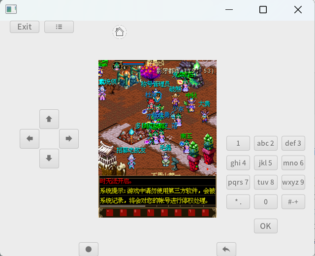

# freej2me On Minijvm
J2me adapted minijvm 

## License
GPL-3.0-or-later. This project is a derivative work of
[FreeJ2ME](https://github.com/hex007/freej2me) (GPL-3.0-or-later), which is
bundled and linked in-process, so the GPL applies to the whole distribution.
See [LICENSE](LICENSE) for details and third-party notices.

## Run
 Download the release and run.   https://github.com/digitalgust/freej2meOnMinijvm/releases/tag/Ver1.0.0

## Build   
Open the project in Idea    
Run maven package task generate freej2meonminijvm.jar    
Run minijvm.exe and install from local file , choose the freej2meonminijvm.jar for install    
run freej2me 
Select a file that's J2me Midlet    

freej2me is a j2me emulator developed in java :    
https://github.com/digitalgust/freej2me    

## MIDI audio

MIDI playback uses the Java SoundFont engine from `android-synth` (BSD-2-Clause).
The Android `AudioTrack` and native ALSA/MIDI drivers are not included; rendered
PCM is sent through MiniJVM's existing XGUI `MaDevice` audio API.

A compact GM SoundFont is bundled at `src/main/resource/midi/` under GPL-3.0-only.
To use another `.sf2` file, set the JVM property
`-Dfreej2me.midi.soundfont=path/to/soundfont.sf2`.
Standard MIDI File formats 0 and 1 are supported.

screen shot:

 

